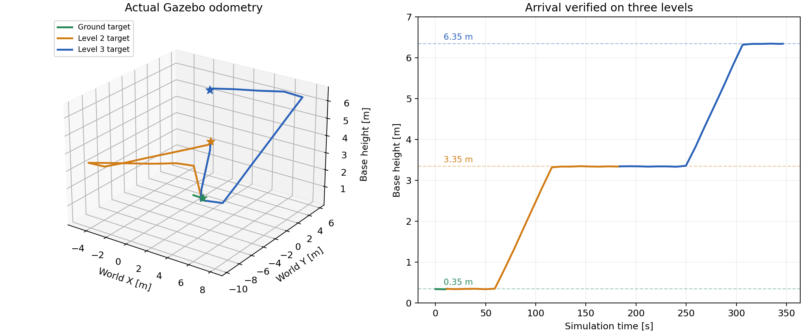

# 三层坡道场景实际导航验收

2026-11-03，在本机 ROS 2 Jazzy、Gazebo 仿真中完成一轮一层 → 二层 → 三层自动行走。验收同时检查执行状态和 `/odom` 的实际位置、高度。

此次验证使用新增的 **building_accessible 简化场景**，包含三层平台、两段连续坡道和侧护栏，使用其碰撞几何导出的配套 PLY。原始 Building 文件保留；本结果不代表原建筑复杂楼梯已经修复。原场景诊断见 [findings_zh.md](findings_zh.md)。

## 修复内容

- 坡面地面曾进入局部障碍地图，导致 `detected collision ahead`。高度过滤器现在结合可通行地形平面去除当前高度附近的地面，保留物体和未知区域；独立清障点云清除历史标记。
- 坡道侧边曾被当作可跨越台阶，规划路径会从侧面进入。场景加入侧护栏，端部保持开放，使路径通过坡道入口。
- 坡顶转弯时曾触碰护栏的碰撞检查范围。全局占用尺寸设为 1.1×1.1 米，在 Nav2 的 0.35 米半径外预留每侧 0.20 米跟踪余量；速度自适应前视时间设为 1.2 秒。
- 跟随客户端原先使用其他机器人的 `arter/base_link` 查询 TF，现通过参数使用 `base`，使路径偏差检查能获得正确位姿。
- Nav2 原有到达判据忽略楼层高度。新增 `HeightAwareGoalChecker`，要求机身高度误差不超过 0.25 米后，再检查平面位置与朝向。回归用例验证：相同 XY、相差一层高度不能报告到达，也不能提前锁存平面到达状态。
- RViz 默认视角改为斜视，便于观察层间结构；完整 MLS 的高度过滤保持关闭。

保留控制器碰撞检查。`maxSlope=0.45`、`maxStepHeight=0.45` 未放宽，外部规划库的地形拟合实验修改已恢复。

## 实际结果

`/goal_pose` 的 Z 为地面高度，机身目标由适配器自动加上 0.35 米。

| 目标 | 地面目标 XYZ（米） | 到达时实际机身 XYZ（米） | 平面误差 | 墙钟耗时 | 执行状态 |
| --- | --- | --- | --- | --- | --- |
| 一层 | (1.000, 0.000, 0.000) | (0.922, -0.002, 0.345) | 7.8 厘米 | 11.5 秒 | COMPLETED |
| 二层 | (0.839, 1.423, 3.000) | (0.763, 1.589, 3.343) | 18.3 厘米 | 181.4 秒 | COMPLETED |
| 三层 | (0.839, 1.423, 6.000) | (0.771, 1.402, 6.346) | 7.1 厘米 | 172.5 秒 | COMPLETED |

二层、三层目标具有相同的 XY；机器人实际分别沿两段坡道到达对应楼层。机身高度相对目标高度的误差均小于 1 厘米。平面误差包含路径端点、局部跟踪及转向过程误差，不能将局部控制器的 0.08 米容差当作最终目标定位精度。



## 复现

先关闭其他仿真实例，在工作区根目录运行：

```bash
source install/setup.bash
ros2 launch go2_bringup accessible.launch.py
```

另一个加载相同环境的终端运行：

```bash
source install/setup.bash
python3 tools/verify_accessible_navigation.py --output /tmp/go2_navigation_verification
cat /tmp/go2_navigation_verification/report.json
```

验收脚本要求任务先进入 `EXECUTING` 再进入 `COMPLETED`，平面误差 ≤0.25 米、机身高度误差 ≤0.40 米；失败会请求停止执行并返回非零退出码。默认每个目标允许 1200 秒，日志每 10 秒记录一次位置和速度。运行期间不要同时发送其他目标。

RViz 使用 **3D Goal Pose** 点击可见的目标楼层地面，拖动设置方向，默认自动执行。俯视时楼板会遮挡下层，应旋转视角露出需要选择的地面。标准 2D Goal Pose 投影到 z=0，不能选择上层。

## 证据与验证边界

- [实际到达报告](accessible_motion_report.json)：三个目标均通过，`success: true`。
- [里程计采样](accessible_motion_odometry.jsonl) 与 [验收日志](accessible_motion_verification.log)：记录上坡、平台行走及到达过程。
- [配置及地图摘要](accessible_motion_manifest.json)：对应世界、1090004 点 PLY、配置和关键源码的 SHA-256。
- [RViz 截图](accessible_rviz.png)：加载同一地图及导航配置，在完成任务后重新打开 RViz 验证晚订阅地图显示。
- [地图统计](accessible_map_stats.json)：三层均存在 MLS 和可通行单元；二层、三层可通行 patch 分别为 6147、6336 个。任务结束后 `/cmd_vel` 为零。
- [跟随器退出日志](accessible_follower_shutdown.log)：独立进程收到 SIGINT 后返回 0；[退出检查](accessible_shutdown_report.json)记录测试 launch 结束后的节点、导航话题及进程组残留情况。

构建通过；10 项 Python 回归测试及 3 项到达检查插件测试通过。测试在独立 ROS domain 运行，避免测试状态消息干扰实际导航任务。

本次完成一轮上行验证。原始 Building 楼梯、下行、连续重复运行及实机定位与行走仍需分别验收。仿真使用真值定位和近似雷达点云。
